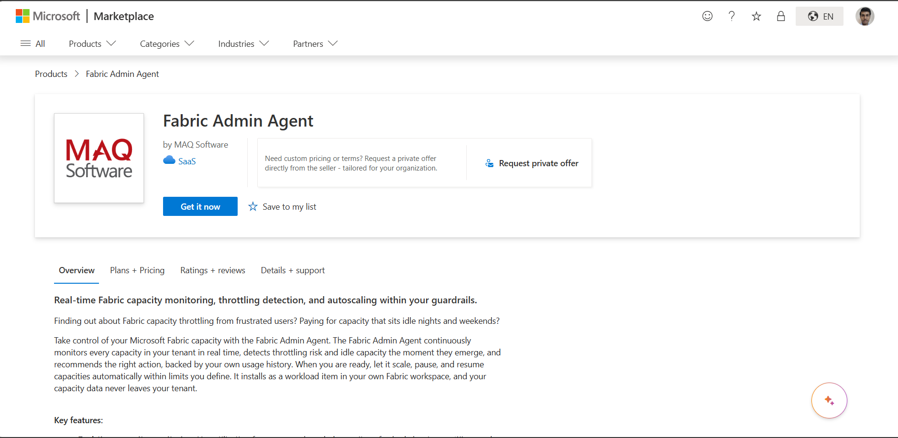
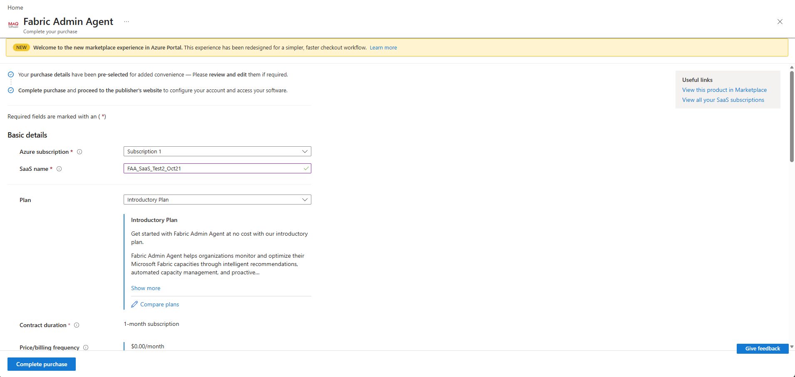
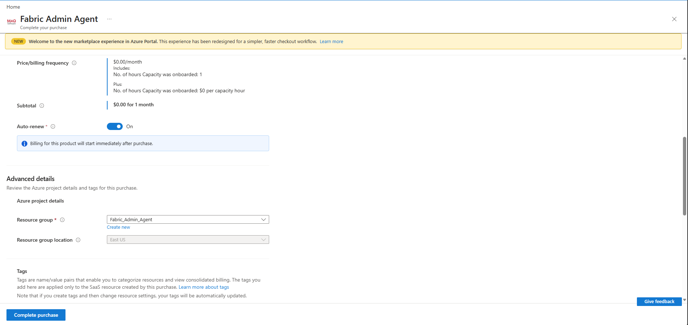
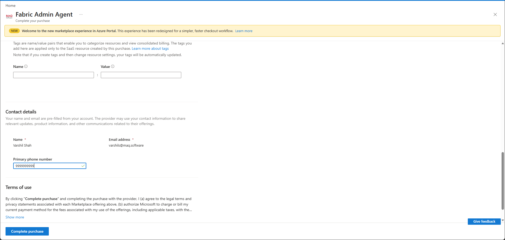
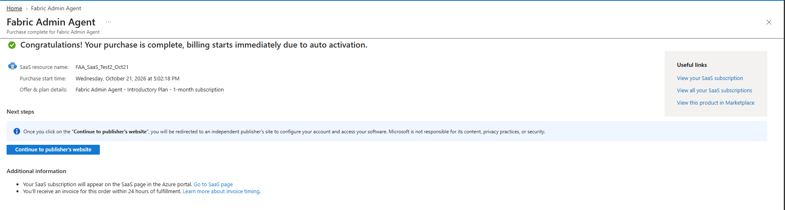
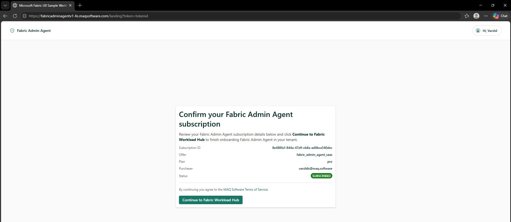

# How to Purchase and Activate Our SaaS Offer

Follow these steps to subscribe to our SaaS offer through the Microsoft Azure Marketplace and activate your account.

## Prerequisites
Before you begin, ensure you have:
- An active **Microsoft Azure Subscription** with a valid payment method. (Note: Student, Visual Studio Enterprise, and free credit subscriptions cannot be used to purchase SaaS products).
- **Contributor** or **Owner** permissions (or a custom role with equivalent SaaS creation permissions) on the Azure subscription and resource group you plan to use for billing.

---

## Step 1: Access the Offer
1. Navigate to our official Azure Marketplace offer page: [Fabric Admin Agent - Marketplace](https://marketplace.microsoft.com/en-us/product/saas/maqsoftware.fabric_admin_agent_saas)
2. If prompted, sign in using the Azure Active Directory (Entra ID) credentials associated with your Azure account.

## Step 2: Initiate the Subscription
1. On the offer page, click the blue **Get It Now** button below the offer title.
2. A dialog box will appear asking you to confirm your profile details and accept the terms of use. Check the box and click **Continue**.
3. You will be automatically redirected to the Azure Portal to configure your SaaS subscription.

## Step 3: Configure Subscription Details
In the Azure Portal, you will be on the "Create a Software as a Service (SaaS)" page. Fill out the **Basic details** and **Advanced details** sections:

1. **Subscription:** Select the eligible Azure subscription you want to be billed against. 
2. **Resource group:** Select an existing resource group or click **Create new** to make a dedicated one for this SaaS resource. *(If your organization uses Azure Policies that restrict resource group creation, you must select an existing one).*
3. **SaaS name:** Enter a unique name for this SaaS subscription (e.g., `MyCompany-SaaS-Service`). Note that you cannot change this name after the purchase is complete.
4. **Plan:** This will be pre-filled with **Introductory Plan**.

## Step 4: Add Tags (Optional)
1. Add any organizational tags you require to help find, organize, and track costs for your SaaS resource later. Azure supports up to 50 tags per resource.

## Step 5: Review Contact details
1. Review your contact details including name and email, which are shared with the seller after purchase. You can also provide an optional phone number.

2. Select Complete purchase. If a required field is missing or a validation fails, the page shows the error and purchase cannot be completed until the issue is resolved.

## Step 6: Subscribe and Complete purchase

1. After clicking the **Complete purchase** button, Azure will process the deployment. 
2. Once the screen updates to confirm your purchase is complete, click the blue **Continue to publisher's website** button. 

3. You will be redirected to a page titled "Confirm your Fabric Admin Agent subscription". 
4. Review your subscription details and click the **Continue to Fabric Workload Hub** button to continue to Fabric Workload Hub for next steps.

---

**Reference Documentation:**
For further details and troubleshooting, please review the official Microsoft guide: [Purchase a SaaS offer in the Azure portal](https://learn.microsoft.com/en-us/marketplace/purchase-saas-offer-in-azure-portal)

---

**Next:** [Workload setup prerequisites →](./prerequisites.md)