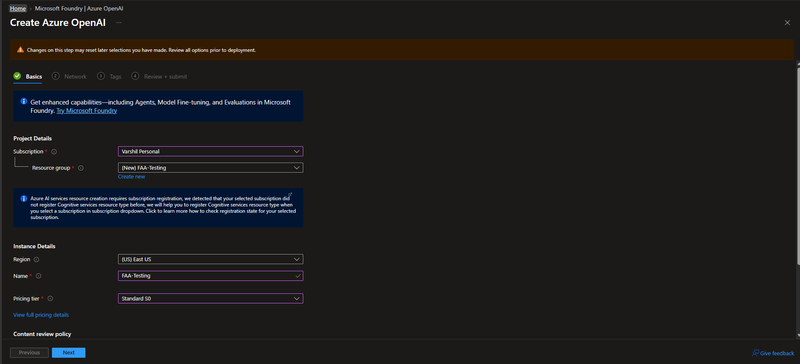
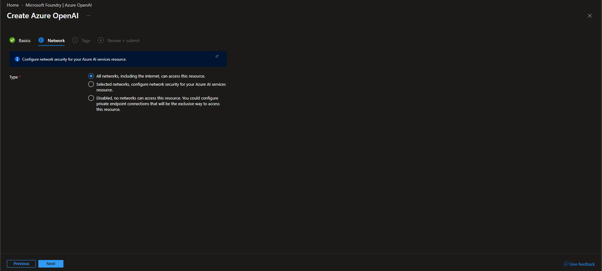
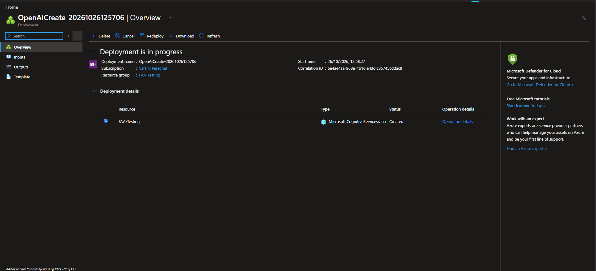
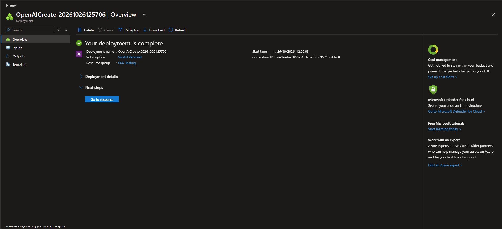
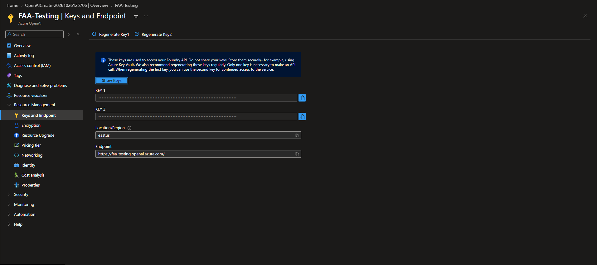
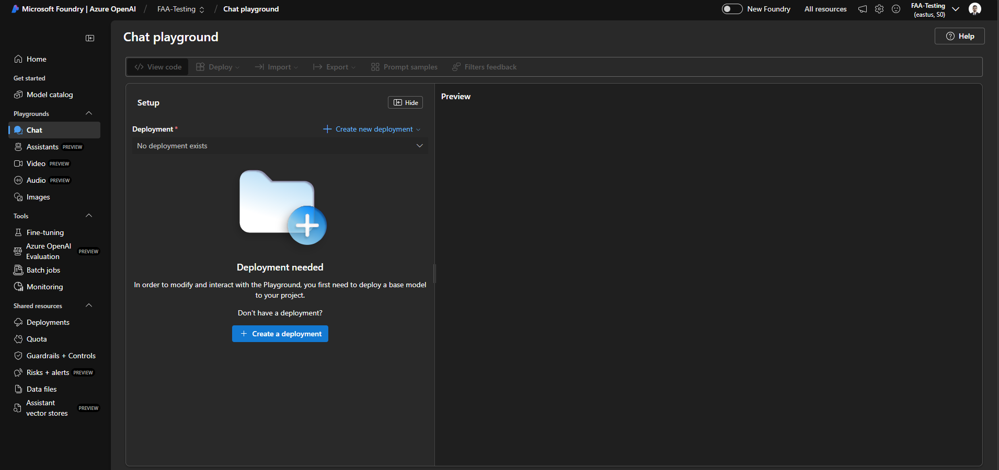
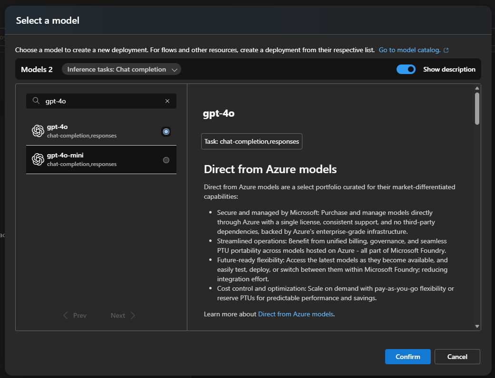
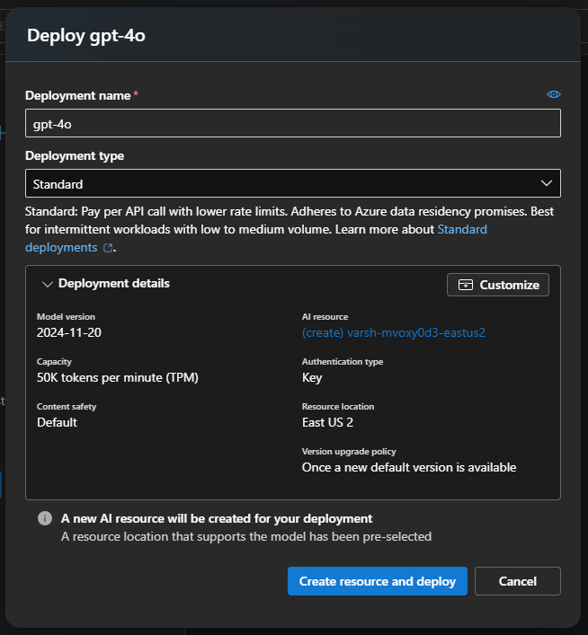
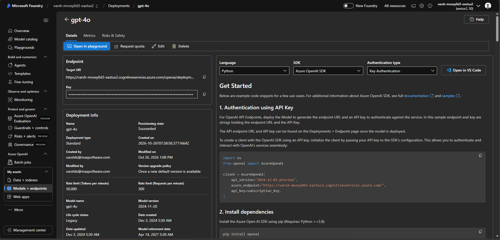

# How to Create an Azure OpenAI Resource and Deploy a Model

This guide will walk you through the step-by-step process of provisioning an Azure OpenAI resource and deploying your first model (such as GPT-4o) using the Azure Portal and Microsoft Foundry (Azure OpenAI Studio).

## Part 1: Creating the Azure OpenAI Resource

**Step 1: Configure the Basics** - Navigate to the Open AI resource in Azure portal ([Azure](https://portal.azure.com/)) and sign in. In the top search bar, search for Azure OpenAI and select it from the Services list. On the Azure OpenAI page, click + Create OpenAI to begin the provisioning process. On the Basics tab, fill out the Project and Instance details:
*   **Subscription**: Select your active Azure subscription.
*   **Resource group**: Select an existing resource group or click **Create new** (e.g., *FAA-Testing*).
*   **Region**: Choose an appropriate region for your resource (e.g., *(US) East US*).
*   **Name**: Provide a unique, recognizable name for your instance (e.g., *FAA-Testing*).
*   **Pricing tier**: Select **Standard S0** (or any other as per requirement).
Click **Next** to proceed.

**Step 2: Configure Network Security** - On the **Network** tab, configure how your resource can be accessed.
*   Select the radio button for: **All networks, including the internet, can access this resource.**
Click **Next** until you reach the final review stage.

**Step 3: Review and Submit** - On the **Review + submit** tab, review all the configuration settings you have made for accuracy. 
*   Once verified, click the **Create** button at the bottom of the screen.

**Step 4: Monitor Deployment** - You will be redirected to an overview page stating **Deployment is in progress**. Wait a few moments for Azure to provision the underlying infrastructure.

**Step 5: Access the New Resource** - Once the provisioning finishes, the screen will update to say **Your deployment is complete**. 
*   Click the **Go to resource** button to manage your new Azure OpenAI instance.

**Step 6: Retrieve API Keys and Endpoint** - In your newly created resource, look at the left-hand navigation pane and select **Keys and Endpoint** (located under *Resource Management*). 
*   Here, you will find **KEY 1**, **KEY 2**, your **Location/Region**, and your **Endpoint** URL. 

---

## Part 2: Deploying a Model

**Step 7: Access the Chat Playground** - Open **Microsoft Foundry** (Azure OpenAI Studio). In the left-hand menu under **Playgrounds**, click on **Chat**. 
*   You will see a message stating "Deployment needed." 
*   Click the **+ Create a deployment** button (or use the *Create new deployment* dropdown).

**Step 8: Select Your Model** - In the **Select a model** window, choose the base model you wish to deploy. 
*   For example, select **gpt-4o** from the list.
*   Click **Confirm** to proceed.

**Step 9: Configure Deployment Settings** - A deployment configuration pane will slide out. Fill in the deployment details:
*   **Deployment name**: Give your model a name (e.g., *gpt-4o*).
*   **Deployment type**: Select **Standard**.
*   Expand **Deployment details** to adjust further settings:
    *   **Model version upgrade policy**: Select your preference (e.g., *Upgrade once new default version becomes available*).
    *   **Model version**: Choose the default version (e.g., *2024-11-20*).
    *   **Resource location**: Ensure a supported location is selected (e.g., *Sweden Central*).
    *   **Tokens per Minute Rate Limit**: Drag the slider to set your quota (e.g., *50K*).
    *   **Enable dynamic quota**: Toggle to **Enabled**.
*   Click **Create resource and deploy**.

**Step 10: View Endpoint Details and Sample Code** - Once your model is successfully deployed, navigate to **Models + endpoints** (under *My assets* in the left menu) and select your newly deployed model (*gpt-4o*).
*   Here, you can view the specific **Target URI** (Endpoint) and **Key** for this deployment.

---

**Return to:** [Azure Open AI Setup for Fabric Admin Agent](./06-azure-openai-api-key.md)